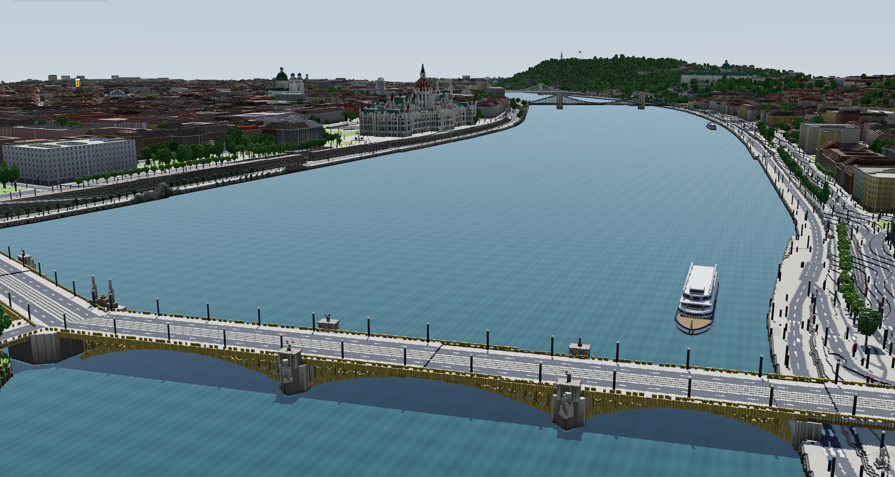
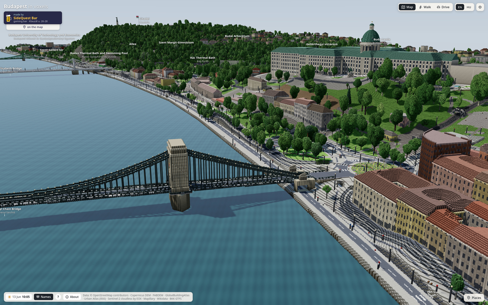
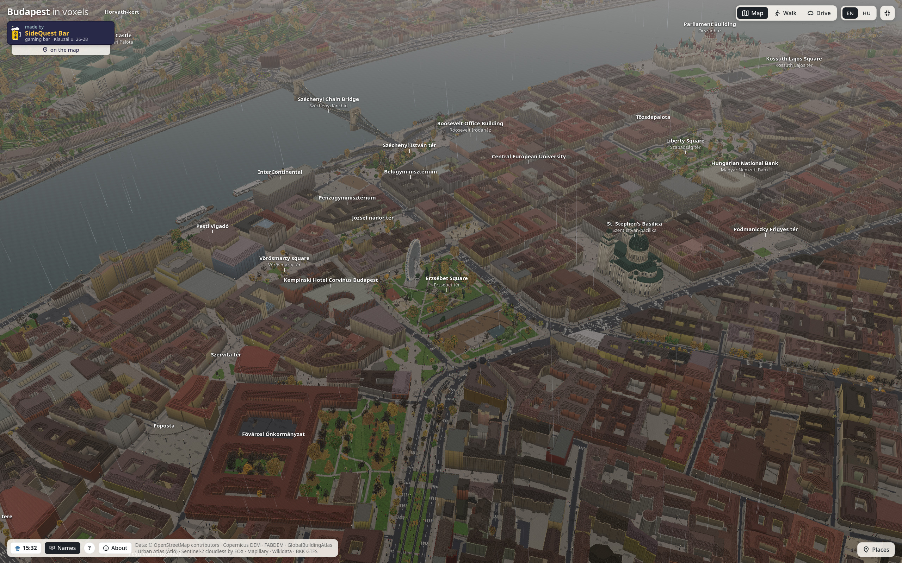
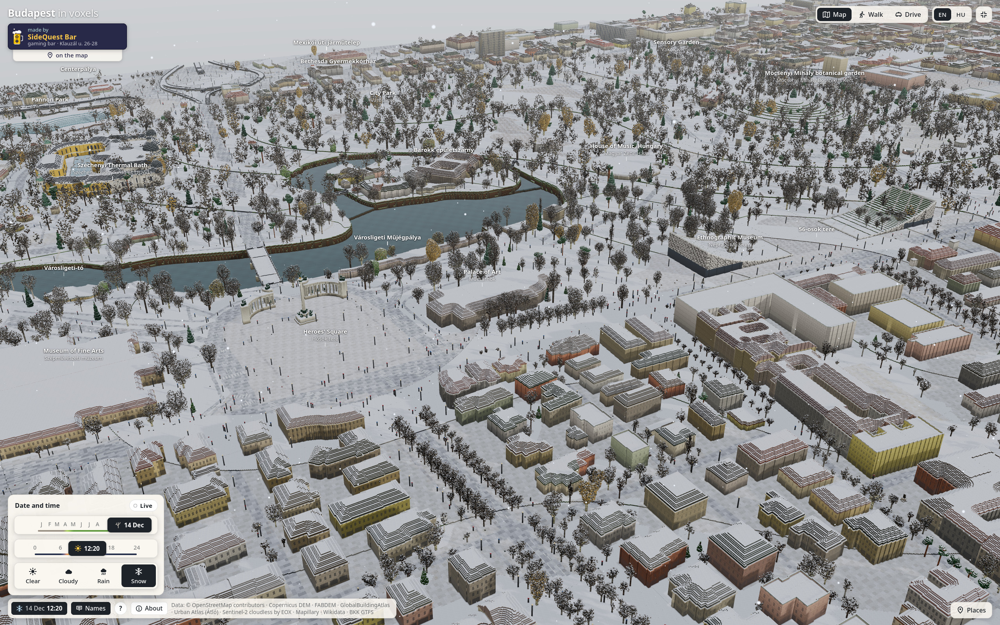
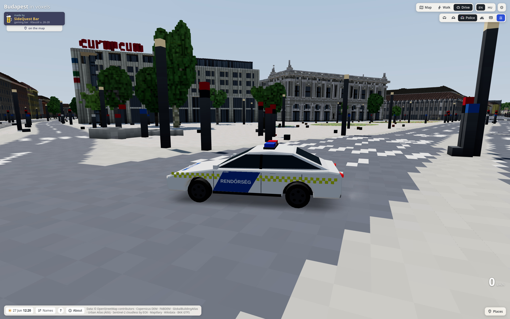
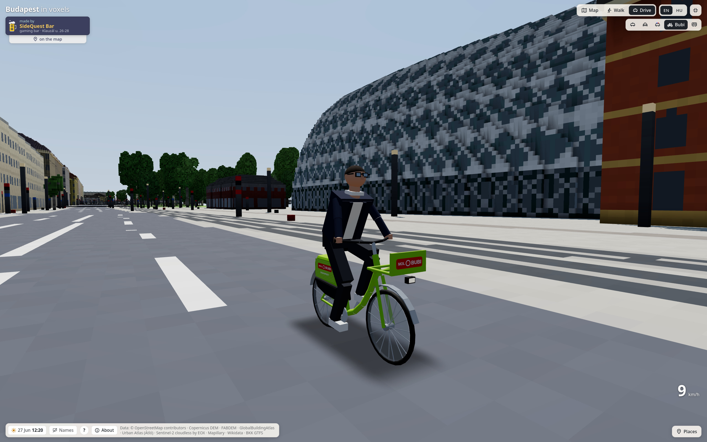

# Budapest in voxels



A 5.4 × 5.0 km diorama of central Budapest in 0.5 m voxels, built only from free data, with thirty-nine landmarks built
by hand. Fly over it, walk its streets or drive through it, in Budapest's live time and weather or any day and hour of
the year, in English or Hungarian. It also runs as a Minecraft server. Made by [SideQuest Bar](https://side-quest.bar);
inspired by Piotr Migdał's [warsaw-vibe-voxel](https://github.com/stared/warsaw-vibe-voxel), whose tile format it uses.

The map runs from Széll Kálmán tér and Castle Hill to Keleti, the Városliget and the Puskás Aréna, and from Margaret
Bridge to Petőfi Bridge.

## Screenshots

| | |
| --- | --- |
|  The Chain Bridge and Buda Castle in June |  The inner city in autumn rain |
|  Heroes' Square and the Városliget in December snow |  Drive mode: a police car on Blaha Lujza tér |



Drive mode on a MOL Bubi bike.

## Quick start

Everything goes through `./bv` (`./bv help` lists it all). Needs [uv](https://docs.astral.sh/uv/), Node 22+ and
[Bun](https://bun.sh); for the Minecraft server also Docker or podman, and JDK 25 with Maven to rebuild its plugin.

```
./bv setup               # checks the tools, installs the dependencies, unpacks the shipped map
./bv web                 # the viewer at http://localhost:5173
./bv server              # the Minecraft server on this machine (asks once about the Minecraft EULA)
```

After changing the map:

```
./bv voxelize            # rebuild the map from the cached sources (~25 min; ./bv map downloads them first)
./bv pack                # pack it into the shipped 19 MB parts, for git
./bv minecraft           # rebuild the Minecraft world from it (~5 min); ./bv server picks it up and restarts
./bv publish-web         # publish the viewer to Cloudflare Pages (~/.config/voxelpest/web.env)
./bv publish-minecraft   # publish the Minecraft server   (~/.config/voxelpest/minecraft.env)
./bv desktop             # the viewer as a Linux desktop app: build/voxelpest-VERSION-x86_64.AppImage
```

The prebuilt tiles come as 19 MB parts (`web/public/voxelpest-data.tar.gz.part-*`), which `./bv unpack` unpacks to
`web/public/data/`.

## Controls

| Mode | |
| --- | --- |
| **Map** | drag to turn, right-drag to move, scroll to zoom; W A S D fly. Click a name to fly there |
| **Walk** | click to look with the mouse; W A S D walk, Shift runs, Space jumps |
| **Drive** | W / S gas and brake, A / D steer, V changes vehicle, R back on the road |

Keys 1, 2, 3 switch modes. Touch screens and controllers are supported; the **?** button shows the controls for the
device in hand.

## Documentation

- [docs/viewer.md](docs/viewer.md): the viewer in detail: controls, vehicles, seasons and weather, URL parameters, code layout
- [docs/data.md](docs/data.md): building the map: sources, build steps, how the data is fused, known limits
- [docs/landmarks.md](docs/landmarks.md): the hand-built landmarks, their dimensions and photo sources
- [docs/publishing.md](docs/publishing.md): the web deployment, the Minecraft server, analytics, the desktop app
- [minecraft/README.md](minecraft/README.md): the Minecraft server's setup, commands and conversion

## Licences and credits

- **Code**: MIT. Inspired by [warsaw-vibe-voxel](https://github.com/stared/warsaw-vibe-voxel) by Piotr Migdał
  (MIT, © 2026): this project uses its tile format (`scripts/tiles.py`, read by `web/src/engine/mesher.worker.ts`), and
  `scripts/tiles.py`, `scripts/osm.py`, `scripts/osm_pbf.py` and `scripts/style.py` (`parse_colour`, the ground palette)
  started from its scripts. The viewer (`web/src/`) is this project's own code; it uses three.js's OrbitControls. Its
  rain streaks (`engine/rain.ts`), the cloud deck's noise (`engine/sky.ts`) and the wet streets (`engine/material.ts`)
  follow warsaw-vibe-voxel's `weather.ts`, `sky.ts` and voxel material; the seasons (`scripts/phenology.py`,
  `scripts/climate.py`, `engine/foliage.ts`, the trees and lawns in `engine/material.ts`) follow its phenology, climate,
  foliage and voxel material, and use its phenology table (DWD and iNaturalist dates, autumn colours and lawns from
  Commons photos).
- **Weather**: [Open-Meteo](https://open-meteo.com) (CC BY 4.0), asked for Budapest's current weather in live mode;
  its historical archive (ERA5, Copernicus Climate Change Service) for the climate and the phenology's shift.
- **Phenology**: Deutscher Wetterdienst, Climate Data Center (phenological observations, via warsaw-vibe-voxel);
  iNaturalist leaf annotations.
- **Data**:
  - © OpenStreetMap contributors (ODbL)
  - Copernicus DEM GLO-30 © DLR e.V. 2010-2014 and © Airbus Defence and Space GmbH 2014-2018, provided under COPERNICUS
    by the European Union and ESA
  - FABDEM V1-2 (Hawker et al. 2022, University of Bristol, CC BY-NC-SA 4.0)
  - Sentinel-2 cloudless – https://s2maps.eu by EOX IT Services GmbH (contains modified Copernicus Sentinel data 2023,
    CC BY-NC-SA 4.0)
  - Mapillary map features (CC BY-SA 4.0)
  - GlobalBuildingAtlas (Zhu et al. 2025, TUM, CC BY-NC 4.0)
  - Copernicus Urban Atlas Building Height 2012, as joined by Átló (atlo.team/boda)
  - Wikidata (CC0)
  - BKK GTFS

The generated tiles inherit the data's non-commercial, share-alike terms (GlobalBuildingAtlas, FABDEM, Sentinel-2
cloudless, Mapillary): check them before publishing.
